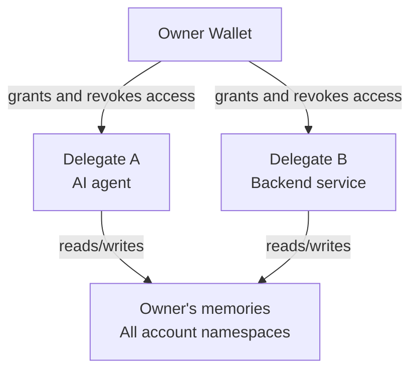

Walrus Memory puts you in full control of your memory. Programmable permissions and explicit ownership define how memory is shared, accessed, and updated, with delegate access for agents and workflows.

## Ownership

Memory content is stored on Walrus under the owner address recorded in a `MemWalAccount`. The account registry permits one account per owner address. The SDK's `accountId` is the account object ID, not the wallet address.

For the relayer-backed client, `key` is a registered delegate private key used to authenticate requests. Its derived wallet address identifies the delegate, not the account owner. The relayer resolves the owner from the selected account.

```ts
const memwal = MemWal.create({
  key: process.env.MEMWAL_PRIVATE_KEY!, // delegate private key
  accountId: process.env.MEMWAL_ACCOUNT_ID!, // MemWalAccount object ID
  serverUrl: process.env.MEMWAL_SERVER_URL,
  namespace: "personal",
});
```

In a [multi-tenant server app](/sdk/cookbook-multi-tenant), the operator owns the account and the memories stored through it. An end user signs in with a wallet to prove identity to that application. Signing in does not create an account for the user or give the user ownership of those memories.

Ownership is separate from payment; see [Managed relayer costs](/relayer/public-relayer#storage-costs).

## Delegates

A delegate is a keypair registered on the account by its owner. The delegate signs requests, and its authority comes from that registration. The owner can add and remove delegates without giving them the owner wallet key.

This enables 2 use cases:

- **Agent access:** give each agent a separate key so you can label and revoke it individually.
- **Service access:** authorize a backend to read and write memory under the owner's account without handing over account-management credentials.

<Warning>
Delegate keys are not scoped to a namespace or a read-only subset of memory. An authorized delegate can access memories across every namespace in the account. Namespaces organize data and scope queries; a multi-tenant application must authenticate users and choose the allowed namespace on its server.
</Warning>



## Access control enforcement

Account authorization and application-user authorization operate at different levels:

- The owner's wallet address controls the account and delegate registrations onchain.
- The relayer verifies that the signing delegate is authorized for the selected account before serving memory requests.
- The [Seal](/fundamentals/architecture/data-flow-security-model) contract policy checks the owner or registered delegate before releasing decryption keys.
- An application using one account for many users enforces each user's namespace access in its own server. The account contract does not distinguish those application users.

Removing a delegate rotates the account's encryption identity for future writes. It does not take back plaintext the delegate already read, or decryption keys it already obtained. Keep the owner key secure so you can manage and replace delegate keys. See [Delegate key management](/contract/delegate-key-management) for revocation steps.
